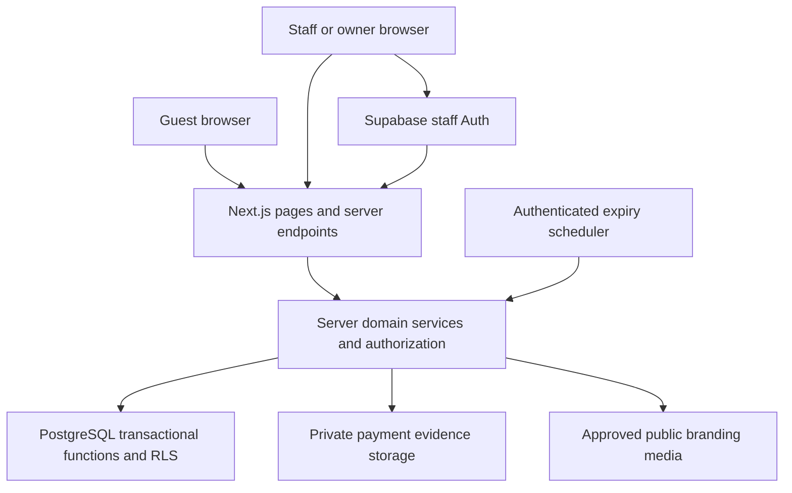

# Proposed MVP architecture

The independent [Phase 3D.1 interface prototype](PHASE-3D1.md) extends the approved
owner-demo baseline with synthetic booking screens only. It does not integrate or
approve unpublished booking/worker code; live architecture below remains planned.

Phase 1 implementation follows the revised scope in [PHASE-1.md](PHASE-1.md):
connection-only Supabase and synthetic presentation data. The live architecture described
here remains planned, including all database and authorization safeguards.

## Application shape

Use a modular monolith: one Next.js App Router application with JavaScript, React,
Tailwind CSS, and Supabase PostgreSQL/Auth/Storage. Deploy one application and one
Supabase project per club/environment. Share code and migrations between future club
deployments; configure identity, courts, timezone, branding, and policies as data.
Do not add tenant routing, tenant IDs, platform billing, or cross-club administration.



Use server-rendered public content and client components for interactive availability,
forms, and dashboards. Route handlers/server actions call shared server domain services;
these services validate inputs, authorize actors, and invoke transactional database
operations. Browser input, quoted prices, role labels, and claimed payment amounts are
untrusted. Never let clients write privileged tables directly.

Proposed organization after approval:

```text
app/                     public, booking, staff routes; server endpoints
components/              accessible UI and court map
lib/server/              auth, booking, payment, settings, storage services
lib/domain/              pure date, money, state, validation helpers
supabase/migrations/     schema, constraints, RLS, grants, transactional functions
supabase/seed.sql         synthetic local club and development fixtures
tests/unit/              Vitest domain tests
tests/integration/       real database, RLS, storage and concurrency checks
tests/e2e/               Playwright guest/staff/owner workflows
docs/                    decisions and operational instructions
```

Pin supported tool versions and use a committed npm lockfile once scaffolding is
approved. Local Supabase CLI/Docker is the proposed integration environment; confirm
container support before relying on it. No external Supabase project is necessary for
the first local implementation milestones. If local containers are unavailable, record
that blocker and request approval for a dedicated test project before creating one.

## Data model and access boundaries

Names below are proposed schema boundaries, not a final migration specification.

| Entity | Purpose and important constraints |
| --- | --- |
| `club_settings_versions` | Versioned public identity, timezone, contact, approved media, branding; effective timestamp, author and change note. |
| `policy_versions` | Versioned operating hours, booking limits, lead time, payment deadlines, cancellation/refund/reschedule rules; validated typed fields. |
| `courts`, `court_config_versions` | Stable court identity/number; layout coordinates/order; effective hours, enablement, and court-specific rental rates. |
| `customers` | Minimal guest name/contact details; server/staff access only; no anonymous enumeration. |
| `bookings` | Guest reference, customer, estimated players, state, immutable original agreement, current agreed revision, creation time, payment due time. |
| `booking_revisions`, `booking_items` | Append-only agreement history and court/time items, price breakdown and policy snapshot for each accepted revision. MVP guest UI selects one court per booking. |
| `court_occupancies` | Authoritative court/time claim for private bookings, open play and maintenance; active flag; half-open timestamp range. |
| `payment_submissions` | Claimed amount/reference, upload object ID, submission time, review outcome; distinct from verified funds. |
| `payment_transactions` | Append-only verified receipts and completed refunds with actor, actual amount and effective date; correction entries instead of destructive edits. |
| `reschedule_requests`, `refund_requests` | Requested/approved/rejected/completed workflow with reason, actor and agreed changes. Approval is not proof of a completed payout. |
| `open_play_events` | Title, public details, validated Reclub URL and linked court occupancies. |
| `staff_profiles` | Auth user ID, active status, owner/staff role; role assignment is privileged. |
| `guest_access_tokens` | Hashed, expiring, scoped capability tokens; rotation/revocation metadata. |
| `audit_events` | Append-only actor/action/entity/timestamp and redacted change metadata. |
| `media_assets` | Storage object, purpose, license/source/attribution, publish approval and replacement metadata. |

Keep financial histories and original agreements immutable. Customer corrections must
not change a historical booking's recorded agreed price or policy. PII retention and
redaction must account for separate financial record obligations.

## Configurable rules and effective dates

Seed initial editable values: five courts; PHP 600/hour (60,000 centavos); a one-hour
minimum; full-hour start times; proposed full-hour duration increments; provisional
08:00–23:00 Manila operating hours; a 60-minute public lead time; and a two-hour maximum
payment window. Durations, increments, rates, court overrides and hours remain data.
Use null for the undecided partial refund percentage, never an invented percentage.

Separate public branding, operational court rules, and contractual policy versions.
Each family uses a stable scope with validated `effective_from` versions. Resolution
selects the latest version effective at the specified instant. Updates serialize per
scope; reject duplicate effective timestamps and ambiguous court overrides. Immediate
changes use database time; scheduled changes have explicit Manila time and UTC instant.
No agent/server-local clock determines activation.

Proposed resolution semantics, subject to owner review:

- Branding and public content resolve at read time.
- Hours, availability and price schedules resolve for each service-time segment. A
  booking spanning a configuration boundary must be valid for every segment, and its
  quote must show any rate change. Initially only whole-hour boundaries are allowed for
  scheduled pricing/hours changes to match hourly bookings.
- Booking/payment/cancellation terms resolve at booking creation, then are snapshotted.
  Store source version IDs and a canonical snapshot with the agreed booking revision.
- A quote includes a version fingerprint and short validity period. Creation reruns
  validation transactionally; a changed total or terms requires renewed guest acceptance.
- A later settings change cannot invalidate/reprice an existing booking. The settings UI
  reports affected bookings; publish only after an explicit resolution plan or a later
  effective date. Never silently cancel existing agreements.
- At rescheduling, preserve the original agreement and require explicit acceptance of
  any changed price/terms as a new revision. The exact grandfathering rule is unresolved.

Owner editing supports drafts, validation, immediate publication or future activation,
and audit history. Reverting creates a new version. Owners cannot edit historical
versions that have already been used by bookings.

## Booking integrity and expiry

Represent all blocking intervals in `court_occupancies`. PostgreSQL uses `btree_gist`
and an exclusion constraint equivalent to:

```sql
EXCLUDE USING gist (
  court_id WITH =,
  occupied_during WITH &&
) WHERE (active);
```

Use a nonempty `tstzrange` with `[start, end)` bounds and finite endpoints. Foreign keys,
checks and narrow transactional functions prevent orphan or malformed occupancies.
The constraint covers private holds, confirmed bookings, open play and maintenance
equally. Database functions also enforce club-hour alignment, allowed duration, court
status and limits; server validation alone is insufficient. Exact functions/grants will
be reviewed in Phase 2.

Reservation creation is one transaction: serialize on the court row, release eligible
expired holds, resolve configuration and price, validate limits, create the booking and
immutable agreement, and insert occupancy. Multiple courts are locked in stable ID
order for staff blocks. Conflict errors return a safe conflict response and refreshed
availability. Anonymous availability is advisory, with no PII or private booking IDs.

Enforce guest lead time using database time. Proposed boundary: starts at or before
`now + 60 minutes` are unavailable to the public; staff can book within that window
through an authorized path. Staff cannot override physical overlaps. Past bookings are
outside the normal creation flow; historical financial corrections are separate.

Proposed payment deadline: `min(created_at + 2 hours, starts_at - 60 minutes)`.
Show the exact deadline before acceptance. This can give guests very short payment
windows near the booking cutoff; owner approval is required before live use.

Use separate booking and payment states. Proposed booking states are
`pending_payment`, `pending_verification`, `confirmed`, `expired`, `cancelled`,
`completed`, and `no_show`. Payment submissions independently track submitted,
verified or rejected claims. Refund requests have their own lifecycle.

- Creation reserves the interval while awaiting payment.
- Evidence accepted before the database deadline changes the booking to
  `pending_verification`; uploading bytes alone does not submit evidence.
- Only staff verification of actual receipt confirms a fully paid booking.
- A due unpaid hold expires and releases occupancy atomically. Never put `now()` in an
  exclusion predicate; expiry explicitly flips active state in a transaction.
- An authenticated scheduler processes due holds at least once per minute, while every
  booking write also expires eligible holds under the same court locks. An expired hold
  may briefly appear unavailable until refreshed; it must not prevent a valid new write.
- Submission versus expiry and verification versus cancellation lock the same booking
  and court records in a documented order. Operations are idempotent, with one legal
  state transition and no late resurrection after an interval has been reassigned.
- Proposed default: evidence submitted in time retains occupancy during manual review;
  show overdue review alerts and require staff resolution. It does not auto-confirm or
  count as revenue. Owner must approve a review deadline/escalation rule.
- Rejecting evidence after the payment deadline requires staff resolution of the booking;
  do not silently grant a fresh payment window or leave an unowned hold indefinitely.

Use an idempotency key for creation, evidence finalization, verification, refunds and
rescheduling. Bind keys to actor/capability and input hash; enforce uniqueness in the DB.
Retries must not create duplicate bookings or financial entries.

## Guest access and GCash evidence

Collect only the approved minimum name/contact fields and estimated player count.
No guest Supabase Auth account is created. A server issues a random booking capability;
the public reference alone never grants access. Exchange token links for a secure,
HttpOnly, SameSite cookie and redirect to a URL without the token; do not log tokens.
Use `Referrer-Policy: no-referrer`, no third-party scripts on private guest pages,
short-lived scoped upload/view access, token expiry and revocation. Recovery requires
an approved identity check; it is not public search by phone number.

Keep payment screenshots in a private bucket. Authorize upload initialization and
finalization against a live capability, booking state and deadline. Use random object
paths, ownership metadata, strict size/type limits and server-verified decoded image
content. MVP proposal: JPEG/PNG/WebP only, maximum 10 MB, strip metadata and normalize
images; reject SVG, HTML and PDFs. Publish no original evidence objects. Validate final
object ownership and content before accepting a submission; clean abandoned uploads.

Staff use authenticated, short-lived signed URLs to view evidence; tokens and signed
URLs must not appear in logs, analytics or audit payloads. Evidence is a financial/PII
record and needs a documented retention and deletion policy.

Staff compare the submission against an independent GCash receipt/transaction record
and record a verified amount and reference. A screenshot alone cannot prove settlement.
Duplicate transaction references are flagged/rejected according to an approved unique
reference scope. Corrections create reversal/adjustment entries; no double verification.
Refund requests and approval do not reduce collected revenue until payout is recorded.
The site presents manual GCash instructions; it never asks for wallet passwords or OTPs.

## Roles, authorization and public content

| Actor | Proposed permissions |
| --- | --- |
| Guest | Read published club/court/availability data; create own booking; view own status; submit own evidence and change requests through scoped capabilities. |
| Staff | Manage court schedule, last-minute bookings, open play, assigned customer data, payment verification and change requests; no role or policy administration. |
| Owner | Staff capabilities plus settings publication, role administration, financial reports, refund approval and sensitive exports. |

Confirm refund execution permissions before implementation. Use deny-by-default RLS
on application tables and Storage; revoke unnecessary anonymous/authenticated grants.
Use safe projections for public availability. Server-only guest operations use carefully
scoped functions, never arbitrary browser-supplied filters with an unrestricted client.
Staff operations should carry the staff JWT so RLS remains effective; resolve the
current active role in the DB rather than trusting an editable profile or stale UI.
Restrict role mutations and audit writes. SECURITY DEFINER functions require a fixed
search path, explicit grants, fully qualified objects, and internal authorization checks.

Use secure SSR auth handling, request origin/CSRF checks for cookie-authenticated
mutations, validation on every endpoint, rate limits, and an approved staff invitation
flow. Require owner MFA before production and assess staff MFA. Cache only public data;
private pages and signed URLs must never enter shared/CDN caches.

Render owner-entered content as plain structured content; do not accept executable HTML.
Validate outbound Reclub links against approved HTTPS hosts. Open-play events block
selected courts through the same occupancy mechanism; links do not imply registration
or attendance sync. Store public branding photos in a separate approved-media bucket,
with file validation, documented license and explicit publication.

## Reports and operational controls

Provide Manila-date filters and clear metric definitions:

- Verified gross receipts: sum of verified incoming transactions by actual receipt date.
- Completed refunds: sum of recorded outgoing refunds by payout date.
- Net collected: verified receipts minus completed refunds for the selected period.
- Unverified claims and pending refund liabilities: separate amounts and counts.
- Booked rental value: agreed booking totals by service date; separate from cash received.
- Court utilization: confirmed/completed private reservation court-minutes divided by
  eligible court-minutes. Eligible minutes use historical opening/court schedules minus
  maintenance/closures, before subtracting private bookings or open play. Report open-play
  allocation separately and provide a combined committed-occupancy measure without
  double-counting. Pending holds, no-shows, and cancelled time are labeled separately;
  actual attendance utilization cannot be inferred without check-in data.

Use synthetic known-value fixtures to verify all formulas. Define how partial periods,
court closures, no-shows, and changed booking revisions affect reporting. Do not present
GCash claims, pending refunds, or booking value as verified cash revenue.

Capture structured redacted errors, audit history and job health. Alert on expiry-job
failure and unreviewed evidence. Before any real customer launch, establish encrypted
backups, tested restore, migration rollback/recovery, staff access revocation, evidence
retention, incident response and a manual booking fallback. Approve hosting, region,
cost limits and required network destinations before external provisioning.

## Verification approach

Vitest covers date boundaries, centavo arithmetic, policy resolution, state transitions
and report calculations. Database integration tests exercise real transactions,
exclusion constraints, RLS, function grants, token scoping and concurrent expiry/payment
races. Playwright covers guest booking/payment, staff verification, owner settings,
open play, mobile interaction, keyboard operation and unauthorized access.

Use deterministic clocks at pure-domain boundaries; verify database-time behavior
against controlled integration fixtures. Run accessibility automation plus manual
keyboard/contrast checks. Use synthetic data and evidence throughout the demo.
Detailed measurable gates are in [ROADMAP.md](ROADMAP.md).
